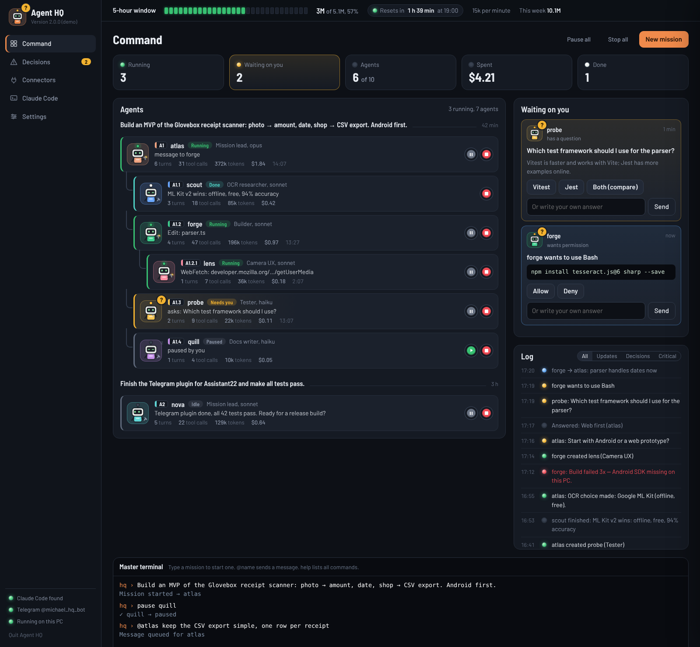

# Agent HQ

A command center for Claude Code agents on Windows. Agents run on your own Claude Code login (your subscription, no API key), create their own helper agents, and ask you for decisions in the dashboard or on Telegram.



## Download

Get `AgentHQ-windows.zip` from the [Releases](../../releases) page, unzip it and run `AgentHQ.exe`. Windows SmartScreen may warn because the exe is not signed: choose **More info → Run anyway**.

Requirements: [Claude Code](https://docs.claude.com/en/docs/claude-code) installed and logged in once (`claude`). Node.js for most connectors.

## What it does

- **Missions**: type what you want done; a lead agent takes it on and can create sub-agents (`spawn_agent`) that work in parallel and report back.
- **Control**: pause, resume and stop any agent, or everything at once. A master terminal accepts missions, `@agent` messages and commands (`help`).
- **Decisions**: agents ask via ⚠️ decisions (pick an option or write your own answer). Commands like Bash ask for permission first, depending on your settings.
- **Telegram**: 🟢 updates, ⚠️ decisions with answer buttons (or 👍/👎, or reply with your own answer) and 🚨 critical alerts. Commands: `/mission`, `/status`, `/agents`, `/msg`, `/pause`, `/resume`, `/stop`, `/usage`.
- **Connectors**: give agents MCP servers such as GitHub, Playwright, Home Assistant, Notion, or your own. Servers already set up in Claude Code are loaded too.
- **Token usage**: 5-hour window bar with reset countdown, read from your local Claude Code logs (an estimate; Anthropic doesn't publish exact plan limits).
- **Claude Code view**: read-only view of your own Claude Code sessions and agent teams.
- English and Dutch, dark and light theme.

## How it works

Each agent is a headless `claude -p` process (stream-json). Agent HQ runs a small local MCP server at `127.0.0.1:7777` that gives every agent the tools `report`, `ask_decision`, `spawn_agent`, `message_agent`, `list_agents` and `complete`, plus a permission-prompt tool. Settings and state live in `%APPDATA%\AgentHQ`.

## Build from source

```
go build -o hq .                                                         # run locally
GOOS=windows GOARCH=amd64 go build -ldflags "-H windowsgui -s -w" -o AgentHQ.exe .
./hq --demo                                                              # demo data, no agents started
```

Pushing a tag like `v4.0.0` builds the exe and attaches it to a GitHub release.

Fonts: Barlow by Jeremy Tribby, SIL Open Font License (`fonts/OFL.txt`).
