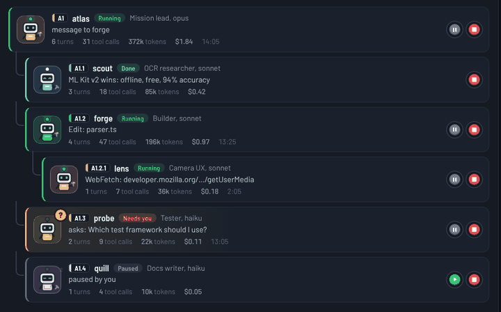

<div align="center">

# Agent HQ

**Run a team of Claude Code agents from one window, and from your phone.**

Give a mission, and a lead agent splits the work, creates its own helper agents and asks you when a decision is yours to make. Runs on your own Claude Code login: your subscription, no API key.

[](https://github.com/mikeey77/agent-hq/actions/workflows/release.yml)
[](https://github.com/mikeey77/agent-hq/releases/latest)

[](LICENSE)


</div>

## Download

1. Download **`AgentHQ-windows.zip`** from the [latest release](https://github.com/mikeey77/agent-hq/releases/latest).
2. Unzip it and run `AgentHQ.exe`. Windows SmartScreen may warn because the exe isn't signed: choose **More info → Run anyway**.
3. The setup asks for your language, finds Claude Code and (optionally) links Telegram.

You need [Claude Code](https://docs.claude.com/en/docs/claude-code) installed and logged in once (`claude`). Most connectors also need Node.js.

Agent HQ keeps itself up to date: it checks for new releases every few hours, and installs them by itself when no agent is working.

## What you can do

| | |
|---|---|
| **Missions** | Type what you want done. A lead agent takes it on and creates helper agents for parts that can run in parallel. Helpers report back automatically. |
| **Control** | Pause, resume and stop any agent or everything at once. Paused agents continue exactly where they were. |
| **Master terminal** | Missions, `@agent` messages and commands such as `pause atlas`, `stop all`, `clear done`, `usage` and `help`. |
| **Decisions** | Agents ask when a choice is yours: pick an option or write your own answer. Commands like Bash ask for permission first, if you want. |
| **Telegram** | 🟢 updates, ⚠️ decisions with answer buttons (or 👍/👎, or reply with your own answer) and 🚨 critical alerts with Pause/Stop buttons. Start missions from your phone with `/mission`. |
| **Connectors** | Give agents GitHub, a browser (Playwright), Home Assistant, Notion, Brave Search and more, or any MCP server. Servers you already set up in Claude Code are loaded too. |
| **Token usage** | A meter for your current 5-hour window with a reset countdown, read from your local Claude Code logs. |
| **Claude Code view** | Read-only view of your own Claude Code sessions and agent teams. |

Every agent has its own little robot that shows what it's doing: hammering, raising its hand when it needs you, sleeping when paused.



### Telegram commands

`/mission <text>` · `/status` · `/agents` · `/msg <agent> <text>` · `/pause <agent|all>` · `/resume <agent|all>` · `/stop <agent|all>` · `/usage`

Any other text you send the bot starts a mission.

## How it works

Each agent is a headless `claude -p` process. Agent HQ runs a small local MCP server on `127.0.0.1:7777` that gives every agent these tools:

| Tool | What it does |
|---|---|
| `report` | Send you an update or a critical alert |
| `ask_decision` | Ask you to choose, and wait for the answer |
| `spawn_agent` | Create a helper agent with its own mission |
| `message_agent` | Talk to another agent |
| `list_agents` | See the whole team |
| `complete` | Finish the mission with a summary |

Permission prompts are routed to you as decisions. Limits keep things under control: maximum agents, maximum running at once, maximum depth of helpers, and a turn limit after which an agent pauses itself.

Settings, agent state and logs live in `%APPDATA%\AgentHQ`.

## Build from source

```bash
go test ./...
go build -o hq . && ./hq --demo          # demo data, no agents started
GOOS=windows GOARCH=amd64 go build -ldflags "-H windowsgui -s -w" -o AgentHQ.exe .
```

### Releasing

Push a tag and GitHub Actions builds `AgentHQ.exe`, zips it with a SHA-256 checksum and publishes the release. Installed copies pick it up automatically.

```bash
git tag v2.2.0 && git push origin v2.2.0
```

## License

MIT. Fonts: Barlow by Jeremy Tribby, SIL Open Font License (`fonts/OFL.txt`).
